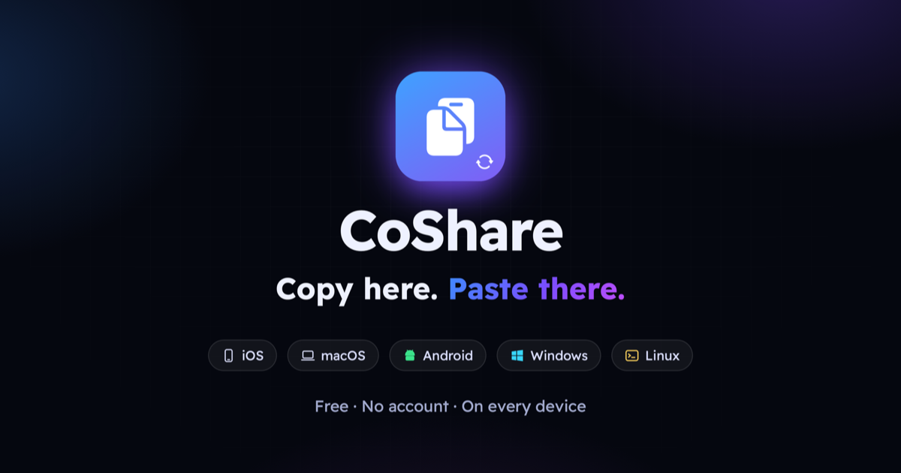

<div align="center">


# CoShare

**Copy here. Paste there. On every device you own.**

One clipboard for iPhone, iPad, Mac, Windows, Linux and Android: across different accounts, over your own Wi-Fi, end-to-end encrypted. No cloud, no sign-up, no ads.

[](https://github.com/Devehab/coshare/releases/latest)
[](https://github.com/Devehab/coshare/releases/tag/android-latest)
[](https://github.com/Devehab/coshare/actions)
[](LICENSE)

**[Website & downloads](https://devehab.github.io/coshare/)** · **[العربية](README.ar.md)** · **[Protocol](docs/PROTOCOL.md)** · **[Contributing](CONTRIBUTING.md)**



</div>

## Why

Copy and paste between devices works beautifully, as long as they all come from the same company and use the same account. Real life is mixed: an iPhone and a Windows laptop from work, an Android phone and a MacBook, a personal Apple ID on one device and a work one on the other.

CoShare doesn't care. It connects your devices directly over your local network, so everything you copy on one is ready to paste on all the others, in about a second.

## Features

- **Every system:** iOS and iPadOS 15+, macOS 12+ (Intel and Apple Silicon), Windows 10/11 (x64 and ARM), Android 8+, and Linux: Ubuntu, Debian, Fedora, RHEL, plus anything else through the AppImage. Supports devices from the last five years and newer.
- **Any account:** different Apple IDs, Google accounts, or none at all.
- **Text and full-quality images:** screenshots arrive byte for byte.
- **Verification codes:** an OTP that reaches your phone can land on your laptop's clipboard automatically (an iOS Shortcut).
- **Device notifications:** know when a device in your group comes in or goes out, and why. *New.*
- **Quiet hours:** CoShare disappears from the network on your work computer during working hours.
- **History that deletes itself:** one day by default, a week at most, images included.
- **Groups:** create one with a password, join from the list or by scanning a QR code. A device can be in several groups.
- **Hotspots too:** a laptop on your phone's hotspot finds the phone directly.

## Private by design

- **No server exists.** Devices find each other with Bonjour (mDNS) and talk over short TCP connections on your network. Nothing goes over the internet.
- **End-to-end encrypted.** Every message is sealed with ChaCha20-Poly1305 under a key derived from the group password (PBKDF2-SHA256, 120,000 rounds, salted with the group ID). Others on the same Wi-Fi only see that a group exists.
- **Nothing to collect.** No accounts, analytics, crash reporting or ads. The [privacy policy](https://devehab.github.io/coshare/privacy.html) lists every byte the app keeps, and where.

## Install

| | |
|---|---|
| **Windows** | [CoShare-Setup-x64.exe](https://github.com/Devehab/coshare/releases/latest/download/CoShare-Setup-x64.exe) · [ARM](https://github.com/Devehab/coshare/releases/latest/download/CoShare-Setup-arm64.exe) |
| **Linux** | `curl -fsSL https://devehab.github.io/coshare/install.sh \| bash`, or a [.deb / .rpm / AppImage](https://github.com/Devehab/coshare/releases/latest) |
| **Android** | [CoShare-android.apk](https://github.com/Devehab/coshare/releases/download/android-latest/CoShare-android.apk) ([install guide](https://devehab.github.io/coshare/#android)) |
| **Mac** | [CoShare-mac.zip](https://devehab.github.io/coshare/downloads/CoShare-mac.zip): first time, right-click → Open (or System Settings → Privacy & Security → Open Anyway) |
| **iPhone & iPad** | Build it on your Mac in one line, below. |

### iPhone and iPad, in one line

CoShare isn't on the App Store yet, so you install it like a developer would, with your own Apple ID (a free one works). Plug the iPhone or iPad into your Mac and run:

```bash
curl -fsSL https://devehab.github.io/coshare/install-ios.sh | bash
```

It installs Xcode if it's missing and checks every step: license, Apple ID, the cable, "Trust This Computer", Developer Mode. Then it builds CoShare from source, installs it and opens it. When something is off it tells you exactly what to tap, and continues by itself once you have. [Step-by-step guide →](https://devehab.github.io/coshare/ios.html)

With a free Apple ID, apps you sign yourself run for 7 days. Run the same line again to renew; your groups and history stay.

### "Is this download safe?"

Browsers and systems warn about apps that aren't sold through their stores or signed with a paid certificate. That says nothing about the code:

- The code is right here. The Windows, Linux and Android builds are made from it by GitHub Actions, in public. [See the builds](https://github.com/Devehab/coshare/actions).
- Every release lists a SHA-256 fingerprint for each file, on the release page and in `SHA256SUMS.txt`, so you can check a download is the same file, byte for byte:
  ```bash
  shasum -a 256 CoShare-Setup-x64.exe
  ```
- New Windows, Linux and Android releases also carry a GitHub build attestation, which proves a file was built by this repository's workflow from a specific commit:
  ```bash
  gh attestation verify CoShare-Setup-x64.exe --repo Devehab/coshare
  ```

## Roadmap, and how you can help

CoShare is a small, documented protocol ([PROTOCOL.md](docs/PROTOCOL.md)) with an app per platform. Bringing it somewhere new means implementing one page and passing one test vector, and the existing apps don't need to change. Ideas we'd love help with:

- [ ] **Store releases.** App Store, Google Play, Microsoft Store, Flathub, Snapcraft. The MIT license lets you publish it under your own account; [tell us](https://github.com/Devehab/coshare/issues/new?template=store-release.yml) and we'll link it from the website.
- [ ] **New systems.** ChromeOS, HarmonyOS, FreeBSD, Linux phones, a command-line peer for servers (`coshare send`, `coshare watch`).
- [ ] **Files.** PDFs and documents, not just text and images.
- [ ] **Search and pins** in the history.
- [ ] **More languages.** The apps speak Arabic and English today.

See [CONTRIBUTING.md](CONTRIBUTING.md) to build any app in a few minutes.

## Repository

```
Shared/     Swift sync engine shared by the iPhone, iPad and Mac apps
iOS/        iPhone and iPad app (SwiftUI)
macOS/      Mac menu-bar app (SwiftUI, AppKit on macOS 12)
desktop/    Windows and Linux app (Electron), byte-compatible with the Swift engine
android/    Android app (Kotlin, Jetpack Compose)
docs/       The protocol
website/    devehab.github.io/coshare, plus the one-line installers
```

Every push is tested on GitHub Actions: unit tests, live sync between the Swift, Node and Kotlin engines, installation on clean Ubuntu, Debian, Fedora and Rocky, and the Windows installer.

## License

[MIT](LICENSE). Use it, change it, ship it, publish it. If CoShare saves you time, a ⭐ helps others find it.
